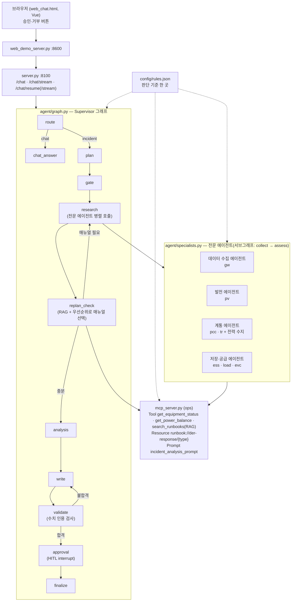

# der_ops_agent — 분산에너지(전력) 운영 에이전트

태양광·ESS·연계점·EV 충전기 같은 분산에너지 설비의 계측 데이터와 대응 매뉴얼을 근거로,
**생산 → 이동 → 저장 → 공급** 전 과정(+ 데이터 수집 층)의 이상을 진단하고 조치를 제안하는 AI 운영 보조 웹 서비스.

SKALA AI Mini-Project 과제 2번(신규 프로젝트). Base AI Agent(`all_total_vue`)의 뼈대를 분산에너지로 옮긴 뒤(Before),
RAG·Multi-Agent·HITL·모듈화·검수 강화·단위 테스트를 더했다(After).

| git 태그 | 내용 |
|---|---|
| `base` | Base AI Agent 원본 |
| `before` | 분산에너지로 이식만 한 버전 (키워드 매뉴얼 선택, 승인 없음) |
| `after` | 개선 버전 (이 문서 기준) |

## 1. 실행 방법

| 순서 | 명령 | 비용 | 용도 |
|---|---|---|---|
| 1 | `bash sh/setup_venv.sh` | 없음 | `.venv` 생성 + 패키지 설치 (최초 1회) |
| 2 | `cp .env.example .env` 후 키 입력 | 없음 | LangSmith·OpenAI 키 (fake 모드는 없어도 됨) |
| 3-a | `bash sh/run_agent_fake.sh` | 없음 | 가짜 LLM(항상 같은 답) — 흐름 확인·테스트용 |
| 3-b | `bash sh/setup_ollama.sh` → `bash sh/run_agent_ollma.sh` | 없음 | 로컬 실모델 (qwen3:0.6b / qwen3:8b / bge-m3) |
| 3-c | `bash sh/run_agent_openai.sh` | **과금** | OpenAI API |
| 4 | `bash sh/run_frontend.sh` (새 터미널) | 백엔드에 따름 | http://localhost:8600 채팅 화면 |
| 5 | `python3 -m pytest` | 없음 | 단위 테스트 28개 |
| 6 | `bash sh/run_eval.sh <fake\|ollama\|openai> <이름>` | 백엔드에 따름 | Before/After 측정 (질문 10개 + 처음 보는 질문 6개) |

## 2. 아키텍처 (After)



## 3. After 개선 내용

| 영역 | Before | After | 파일 |
|---|---|---|---|
| **RAG** | 알람 문장의 키워드를 목록 순서대로 찾아 매뉴얼 1개 | 질문 의미 검색(임베딩) + 데이터 근거 가산점 + 우선순위 규칙. 주 매뉴얼 + 안전 이슈 매뉴얼 | `agent/rag.py`, `agent/selection.py`, `mcp_server.py`(search_runbooks) |
| **Multi-Agent** | research 노드 하나가 모든 설비를 조회만 | 단계별 전문 에이전트 4개(서브그래프)가 병렬로 조회·점검. 숫자 판단은 코드가, 상황 요약은 LLM이 | `agent/specialists.py` |
| **HITL** | 설비를 움직이는 조치도 그대로 출력 | 제어 조치가 있으면 `interrupt()`로 멈추고 운영자 승인/거부 후 재개 | `agent/approval.py`, `graph.py`(approval), `server.py`(/chat/resume), `web_chat.html` |
| **MCP 확장** | Tool 1개 | Tool 3개(계측 조회, 전력 수지 계산, 매뉴얼 검색) | `mcp_server.py` |
| **검수 강화** | 30자 + "1)" | + 보고서 수치가 수집 자료에 실제로 있는지 검사 | `agent/validation.py` |
| **모듈화** | 판단 기준이 코드 5개 파일 16곳에 흩어짐 | `config/rules.json` 한 곳 + 지시문 `agent/prompts.py` 한 곳 | `agent/config.py`, `agent/prompts.py` |
| **단위 테스트** | 없음 | pytest 28개 | `tests/` |

### 매뉴얼 선택 규칙 (agent/selection.py)
1. 최종 점수 = 질문 의미 점수 + (전문 에이전트가 **데이터로 확인한 이상**이면 가산점 0.15)
2. 1등 점수가 기준 이상 → 질문 의도에 맞는 **주 매뉴얼**
3. 기준 미만(의도 불분명) → 데이터로 확인된 이상 중 **우선순위 1등** (안전 > 데이터 신뢰 > 계통 > 비용 > 효율)
4. 데이터로 확인된 **안전 이슈**(ESS 과열·충전 상한)가 주 매뉴얼과 다르면 함께 안내

## 4. Before/After 측정 결과 (fake 백엔드, 같은 측정 스크립트)

| 항목 | Before | After |
|---|---|---|
| 판단 정확도 (10문항) | 10/10 | 10/10 |
| **주 매뉴얼 정답률** (9문항) | **7/9** | **9/9** |
| **안전 이슈 안내율** | **2/4** | **4/4** |
| **미승인 제어 조치 문장** | **7건** | **0건** |
| 근거 없는 수치 | 0 | 0 |
| 평균 지연 | 0.73초 | 0.73초 |
| 비용 (10문항, 가상 단가) | $0.007217 | $0.008233 (+14%) |
| 평균 MCP 호출 | 3.8회 | 5.2회 |
| 판단 기준이 적힌 코드 위치 | 5개 파일 16곳 | 설정 1 + 지시문 1 |
| 처음 보는 질문 6개 — 주 매뉴얼 | 1/6 | 2/6 (판단 정확도가 2/6이라 상한이 2) |

자세한 문항별 결과: [regression_test_queries.md](regression_test_queries.md), 원본 수치: `eval/results/*.json`

## 5. 한계와 트레이드오프

| 한계 | 내용 | 대응 방향 |
|---|---|---|
| fake 라우터의 키워드 한계 | 처음 보는 질문 6개 중 4개를 잡담으로 오분류("줄여야", "잔량", "인버터" 등 미포함). Before/After 공통 | 실제 LLM(Ollama/OpenAI)으로 측정 필요. 키워드를 늘리는 건 테스트 문항에 맞추는 과적합이 될 수 있음 |
| 비용·호출 증가 | 전문 에이전트 요약(LLM)과 매뉴얼 검색으로 비용 +14%, MCP 호출 +37% | 요약을 문제 있는 에이전트만 하도록 제한 가능 |
| 임베딩 기준값 미보정 | ollama·openai용 점수 기준(min_score 등)은 가정값 | 실제 모델로 측정 후 `config/rules.json`에서 조정 |
| 증상 예시와 테스트 문항의 유사성 | 매뉴얼의 '증상 예시'를 사람이 썼고 테스트 질문과 표현이 비슷 → 점수가 후하게 나올 수 있음 | 처음 보는 질문 세트(holdout)를 따로 측정 |
| 승인 대기 상태가 메모리에만 저장 | 서버를 재시작하면 대기 중인 승인이 사라짐 | SQLite 체크포인터로 교체 |
| 승인 대상 판정이 문구 기반 | "(운영자 승인 필요)" 표시나 정해진 문구가 없으면 놓칠 수 있음 | 조치 문장을 구조화(JSON)해서 받기 |
| 가상 데이터 | 계측값은 고정 스냅샷 1개 | 실제 EMS 연동 시 `mcp_server.py`만 교체 |
| 벡터 DB 없음 | 매뉴얼 9개라 메모리 보관 | 수백 개 이상이면 Chroma·FAISS |

## 6. Ollama → OpenAI 전환

코드는 바꿀 필요 없다. 두뇌(LLM)와 매뉴얼 검색(임베딩)이 환경변수 `LLM_BACKEND` 하나로 같이 바뀐다.

| 할 일 | 명령 / 위치 |
|---|---|
| 1. 키 입력 | `.env`에 `OPENAI_API_KEY=sk-...` (커밋 금지) |
| 2. 에이전트 실행 | `bash sh/run_agent_openai.sh` (fast=gpt-4o-mini, quality=gpt-4o, 임베딩=text-embedding-3-small) |
| 3. 측정 | `bash sh/run_eval.sh openai after` |
| 4. 기준값 보정 | 측정 결과의 매뉴얼 점수를 보고 `config/rules.json`의 `rag.min_score.openai`, `rag.evidence_min_score.openai` 조정 |
| 모델 바꾸기 | `.env`에 `OPENAI_FAST_MODEL=...`, `OPENAI_QUALITY_MODEL=...` / 임베딩은 `config/rules.json`의 `rag.openai_model` |

## 7. 판단 기준 수정 방법

모든 기준은 `config/rules.json`에 있다(항목마다 `_설명` 메모 포함). 수정 후에는:
```
python3 -m pytest                  # 기준을 바꿔 테스트가 깨지면 테스트 기대값도 함께 수정
bash sh/run_eval.sh fake after     # Before/After 재측정 (Before는 before 태그에서 같은 스크립트로)
```
