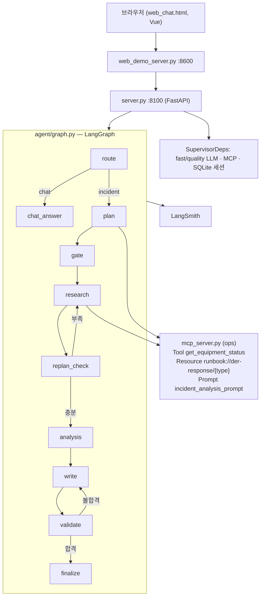

# der_ops_agent — 분산에너지(전력) 운영 에이전트

태양광·ESS·연계점·EV 충전기 같은 분산에너지 설비의 계측 데이터와 대응 매뉴얼을 근거로,
**생산 → 이동 → 저장 → 공급** 전 과정(+ 데이터 수집 층)의 이상을 진단하고 조치를 제안하는
AI 운영 보조 웹 서비스다.

SKALA AI Mini-Project 과제 2번(신규 프로젝트)으로, Base AI Agent(`all_total_vue`)의 뼈대
(LangGraph 노드 9개, MCP, 재시도, 세션, SSE, LangSmith)를 그대로 쓰고 내용물을 분산에너지로 바꿨다.

## 실행 방법

| 순서 | 명령 | 비용 | 용도 |
|---|---|---|---|
| 1 | `bash sh/setup_venv.sh` | 없음 | `.venv` 생성 + 패키지 설치 (최초 1회) |
| 2 | `cp .env.example .env` 후 키 입력 | 없음 | LangSmith·OpenAI 키 (fake 모드는 없어도 됨) |
| 3-a | `bash sh/run_agent_fake.sh` | 없음 | 가짜 LLM(항상 같은 답) — 흐름 확인·회귀 테스트용 |
| 3-b | `bash sh/setup_ollama.sh` → `bash sh/run_agent_ollma.sh` | 없음 | 로컬 실모델(qwen3) |
| 3-c | `bash sh/run_agent_openai.sh` | **과금** | OpenAI API |
| 4 | `bash sh/run_frontend.sh` (새 터미널) | 백엔드에 따름 | http://localhost:8600 채팅 화면 |
| 5 | `python3 eval/run_regression.py --label before` | 백엔드에 따름 | 질문 10개로 Before/After 측정 |

## 전력 흐름 단계와 설비 (data/monitoring.json)

| 단계 | 설비 ID | 이름 | 주요 계측값 |
|---|---|---|---|
| 수집 | gw-01 | 계측 게이트웨이 | 마지막 수신 경과, 결측률 |
| 생산 | pv-01, pv-02 | 태양광 1·2호기 | 출력 kW, 일사량, 발전 효율(PR) |
| 이동 | pcc-01 | 계통 연계점(수전) | 수전·역송 kW, 계약전력, 오늘 15분 최대수요 |
| 이동 | tr-01 | 변압기 | 부하율, 모선 전압 |
| 저장 | ess-01 | ESS 1호기(옥내) | SOC, 충전 상한, 충전 kW, 셀 최고온도 |
| 공급 | ess-02 | ESS 2호기(옥외) | SOC, 방전 하한, 방전 kW |
| 공급 | load-01 | 단지 부하 | 부하 kW |
| 공급 | evc-01 | EV 충전기 | 충전 전력, 사용 중 충전구, 데이터 경과 |

계측값은 **전력 수지가 맞는 고정 스냅샷**이다:
태양광 270 + 96 + ESS 2호기 방전 30 + 수전 0 = **396kW** = 부하 230 + EV 60 + ESS 1호기 충전 70 + 역송 36.

## 대응 매뉴얼 9종 (data/runbooks/, MCP Resource `runbook://der-response/{type}`)

| 단계 | 매뉴얼 | 상황 |
|---|---|---|
| 수집 | comm-loss | 계측 통신 두절·결측 |
| 생산 | pv-underperform | 태양광 발전 효율 저하 |
| 생산 | curtailment | 출력제어(역송 제한) 지시 |
| 이동 | voltage-rise | 역송으로 인한 모선 전압 상승 |
| 이동 | peak-demand | 15분 최대수요가 계약전력에 근접 |
| 저장 | ess-soc-limit | ESS 충전 상한 초과 (옥내 80%·옥외 90%, 2020 ESS 안전대책) |
| 저장 | ess-overheat | ESS 셀 과열 |
| 공급 | ess-soc-low | ESS 방전 하한 근접 |
| 공급 | dr-event | 수요반응(DR) 감축 요청 |

## 아키텍처

## Base(all_total_vue) 대비 변경 요약 — Before 버전

| 파일 | 구분 | 내용 |
|---|---|---|
| `data/monitoring.json` | 변경 | 서버 6대(CPU·메모리) → 설비 9대(단계·별칭·metrics 묶음·알람) |
| `data/runbooks/*.md` | 변경 | IT 장애 매뉴얼 6종 삭제 → 분산에너지 매뉴얼 9종 |
| `agent/equipment.py` | **추가** | 설비 목록·한국어 별칭 찾기·계측값 표시 형식을 한 곳에서 제공 |
| `mcp_server.py` | 변경 | Tool `get_monitoring_status` → `get_equipment_status`, URI·진단 절차 변경, 무작위 흔들기 제거 |
| `mcp_server_docs.py` | 변경 | 미끼 문서 내용만 분산에너지 참고 문서로 |
| `agent/graph.py` | 변경 | 설비 찾기, Tool 이름, 매뉴얼 선택 키워드 규칙 |
| `agent/fake_llm.py` | 변경 | 이상 판단 단어, 설비 찾기, 보고서 문장 |
| `agent/ollama_llm.py`, `agent/openai_llm.py` | 변경 | 프롬프트(라우터·계획·분석·작성·대화)를 분산에너지 운영 맥락으로 |
| `agent/supervisor_v1.py`, `agent/mcp_client.py` | 변경 | 기본 조사 설비·Tool 이름 |
| `web_chat.html` | 변경 | 제목·안내 문구·진행 단계 문구 |
| `sh/run_agent_fake.sh` | **추가** | 무료 fake 모드 실행 스크립트 |
| `eval/testset.json`, `eval/run_regression.py` | **추가** | 질문 10개 + Before/After 측정 스크립트 |

노드 구성, MCP 클라이언트 구조, 재시도, 세션 저장, SSE 스트리밍, 프록시는 Base와 같다.

## Before 측정 결과 (fake)

판단 정확도 10/10, **매뉴얼 정답률 7/9**. 자세한 내용은 [regression_test_queries.md](regression_test_queries.md).
